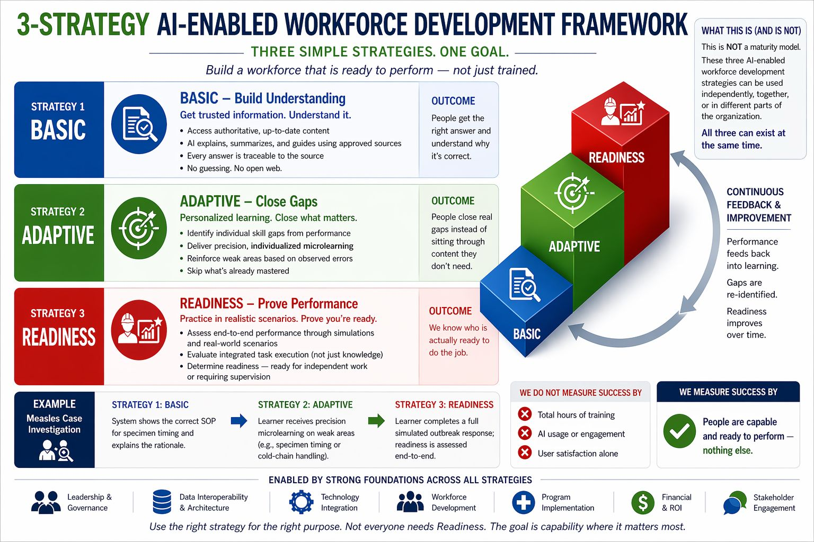

**A-FIRST**

**AI-Enabled Frontline Integrated Readiness and Skills Training**

|                     |                                                                                                        |
|---------------------|--------------------------------------------------------------------------------------------------------|
| **Project Lead**    | Dr. Abel Mestie Mekonnen, MD; Public Health Informatics Fellow, Africa CDC                             |
| **Project Sponsor** | Africa CDC                                                                                             |
| **Advisory Team**   | Dr. Herman Tolentino (US CDC); Dr. Tadesse Wuhib (US CDC); Bekure Tamirat and Adam Terefe (Africa CDC) |
| **Date**            | April 2026                                                                                             |
| **Status**          | Draft for advisory review                                                                              |

# **1. Executive Summary**

A-FIRST is an applied research project under the Africa CDC Public Health Informatics Fellowship, delivered jointly with the US CDC Division of Global Health Protection. The project tests whether AI integrated into the Africa CDC learning management system produces measurable competency gains in frontline public health practitioners across the African Epidemic Service Public Health Informatics track.

Version 3.0 narrows the scope based on direct guidance from the technical advisory team during the April 24, 2026 sprint review. The project commits to two of the three strategies in the AI-Enabled Workforce Development Framework: BASIC (Build Understanding) and ADAPTIVE (Close Gaps). The third strategy, READINESS (Prove Performance), is documented as a future phase and excluded from fellowship deliverables.

This refined plan answers four questions:

-   What specific outcome does the project achieve, and where does scope end?

<!-- -->

-   Which existing content does the project use, and how does it avoid being consumed by course development?

-   Which Moodle integration path produces the best balance of speed, cost, and learning impact?

-   How does the project execute as weekly sprints with tracked progress on Jira?

The plan commits to existing Africa CDC content from the Public Health Informatics course library, a hybrid Option 1 plus Option 2 integration approach using native Moodle AI plugins layered with DataCurso and Nolej, and a 12-sprint cadence aligned to the fellowship calendar.

# **2. Vision, Strategy, Operations, Tactics**

The project structure follows the framework: vision, strategy, operations, and tactics. The four levels interact continuously rather than running in sequence.

## **2.1 Vision**

Frontline public health practitioners across the African Epidemic Service complete training on the Africa CDC LMS and demonstrate measurable understanding of core competencies, with AI helping them get the right answer the first time and close personal skill gaps without sitting through content they have already mastered.

## **2.2 Strategy**

The project applies the 3-Strategy AI-Enabled Workforce Development Framework. Two of the three strategies are in scope for the fellowship period.

|               |                                                                          |                                                                                                                                    |                                                                                   |
|---------------|--------------------------------------------------------------------------|------------------------------------------------------------------------------------------------------------------------------------|-----------------------------------------------------------------------------------|
| **Strategy**  | **Purpose**                                                              | **Mechanism**                                                                                                                      | **Fellowship Status**                                                             |
| **BASIC**     | Build Understanding. Get trusted information. Understand it.             | AI explains, summarizes, and answers questions using approved Africa CDC content. Every response traceable to source. No open web. | **In scope. Primary deliverable.**                                                |
| **ADAPTIVE**  | Close Gaps. Personalized learning that targets what each learner needs.  | System identifies skill gaps from quiz performance, delivers individualized microlearning, skips mastered content.                 | **In scope. Secondary deliverable, layered onto BASIC.**                          |
| **READINESS** | Prove Performance. Practice in realistic scenarios. Prove you are ready. | End-to-end simulation, integrated task execution, readiness assessment for independent work.                                       | **Out of scope. Documented as Phase 4 future work, with handover specification.** |

## **2.3 Operations**

Operations cover the tasks that move the project from current state to deliverables. The operations layer breaks into six work streams:

-   Content alignment with the existing Africa CDC Public Health Informatics course library.

-   Technical configuration of Moodle, including native AI plugin enablement and source-grounded chat.

-   AI integration through DataCurso for course-level recommendations and Nolej for interactive H5P content.

-   Pilot design with frontline learners drawn from the African Epidemic Service Public Health Informatics track.

-   Evaluation against the success measure: people are capable and ready to perform at the BASIC and ADAPTIVE levels.

-   Governance, ethical clearance, and documentation.

## **2.4 Tactics**

Tactics cover the resources, tools, and weekly execution method:

-   Project tracking on Jira, organized as 12 one-week sprints aligned to the Friday advisory review cadence.

-   WhatsApp working group for between-sprint coordination, with Friday check-ins reserved for review and decision.

-   Local development environment on the project lead's workstation, hosting Moodle and small open-source models for early testing.

-   Africa CDC servers as the production target, with GPU-capable infrastructure expected from the parallel CDR project procurement.

-   Continuous documentation in the Africa CDC project repository, including risks, decisions, and sprint outputs.

# **3. Scope**

## **3.1 In Scope**

-   **Strategies:** BASIC and ADAPTIVE.

-   **Audience:** African Epidemic Service Public Health Informatics fellows in the current cohort. Cohort size confirmed during Sprint 2.

-   **Content:** Existing Africa CDC course library, anchored on the Public Health Informatics curriculum. No new course development.

-   **Platform:** Africa CDC Moodle environment, with one or two pilot courses configured for AI integration.

-   **Integration:** Hybrid of Option 1 and Option 2 from the AI Integration Options analysis. Native Moodle AI plugins as the foundation, DataCurso and Nolej layered for course-level recommendations and interactive content.

-   **Evaluation:** Pre and post pilot competency assessment, learner experience survey, and a structured comparison against the framework success criterion.

## **3.2 Out of Scope**

-   **READINESS strategy.** End-to-end simulation and performance assessment are documented as a future phase. The project produces a handover specification but does not implement.

-   **New course development.** The project does not author new content, including AI literacy modules, during the fellowship.

-   **Custom AI recommendation engine.** Option 3 of the AI Integration Options analysis is excluded. The project does not build a custom recommender on top of Moodle data.

-   **Production-grade local LLM deployment on Africa CDC servers.** Local model hosting depends on the CDR procurement of GPU-capable servers. The project tests local models in development only and uses cloud or open API endpoints during the pilot.

## **3.3 Assumptions**

-   The Africa CDC Public Health Informatics course library is accessible and authoritative for the pilot.

-   Africa CDC Moodle administrators grant configuration access for the pilot courses within Sprint 1.

-   The advisory group continues weekly Friday reviews through the sprint cycle.

-   Ethical clearance for learner participation completes before Sprint 6.

-   DataCurso and Nolej trial or institutional licensing is achievable inside the project budget.

# **4. Audience and Content**

## **4.1 Target Audience**

The pilot targets fellows in the African Epidemic Service Public Health Informatics track. This cohort is the right test audience for three reasons:

-   They engage with Africa CDC public health informatics content as part of their fellowship requirements.

-   Their performance data will sit inside the Africa CDC LMS, which the project already controls.

-   Their feedback channels through the fellowship structure shorten the loop between observation and refinement.

Cohort size, language preferences, and baseline competencies are confirmed in Sprint 2 through a learner profile survey.

## **4.2 Content Strategy**

The project uses existing Africa CDC content as developing new courses would consume the project and shift the fellowship away from AI application toward course design.

Two existing Africa CDC courses are candidates for the pilot. Selection is finalized in Sprint 1:

-   Public Health Informatics core module from the Africa CDC course library.

-   A second module to be confirmed based on SCORM packaging quality and learner enrolment volume.

If AI literacy content is required for context-setting, the project requests a short pre-existing module rather than commissioning new content.

# **5. AI Integration Approach**

# 

The integration strategy combines Option 1 and Option 2 from the AI Integration Options analysis. This hybrid balances immediate value with course-level personalization without taking on the cost and risk of a custom recommendation engine.

## **5.1 BASIC Layer: Native Moodle AI Plus Source-Grounded Chat**

-   Native Moodle AI plugins for chat assistance, summarization, and explanation.

-   Source grounding so the AI answers from approved Africa CDC content rather than the open web. Retrieval-augmented generation reduces hallucination risk.

-   Adaptive Quiz activity for performance-based difficulty within a single course.

-   Conditional release rules so learners progress through topics based on quiz outcomes.

-   Model selection prioritizes cost-effective options. The project tests open-source models locally first, then evaluates cloud endpoints (Claude, OpenAI, Gemini) on accuracy, latency, and per-token cost. Procurement and subscription routes are confirmed in Sprint 3.

## **5.2 ADAPTIVE Layer: AI-Enhanced Plugins**

-   DataCurso AI for course-level recommendations and learner analytics.

-   Nolej AI for generating interactive H5P content at sub-unit level, where SCORM granularity is too coarse.

-   Targeted reinforcement on weak areas based on observed quiz errors and engagement patterns.

-   Skip logic for content the learner has already demonstrated competency on.

## **5.3 SCORM and H5P Decision**

SCORM packages are treated as single activities by Moodle, which limits sub-unit AI recommendations. The project addresses this through a two-track approach:

-   Where existing courses are SCORM, the project applies BASIC layer features and uses xAPI where the package supports it.

-   For at least one pilot course, the project converts or supplements SCORM content with H5P interactive elements through Nolej, enabling deeper ADAPTIVE personalization.

## **5.4 Local Models, Cloud Models, and Cost**

The project plans for three model deployment scenarios, in order of preference:

-   Local open-source model on Africa CDC GPU servers, once CDR procurement completes. Best for sovereignty and recurring cost.

-   Local open-source model on the project lead's GPU-enabled workstation for development and small-scale testing.

-   Cloud endpoint (Claude or comparable) during the pilot if local infrastructure is not ready in time. Cost is capped through quotas and prompt-length controls.

# **6. Sprint Plan**

The project executes as 12 one-week sprints, aligned to the Friday advisory review cadence agreed with. Each sprint has a goal, deliverables, and a Friday review checkpoint. Jira tracks the backlog and burndown. WhatsApp handles between-sprint coordination.

|            |                                                  |                                                                                                                                                                             |              |
|------------|--------------------------------------------------|-----------------------------------------------------------------------------------------------------------------------------------------------------------------------------|--------------|
| **Sprint** | **Goal**                                         | **Friday Deliverables**                                                                                                                                                     | **Layer**    |
| **1**      | **Scope lock and pilot course selection**        | Refined plan signed off. Two candidate courses confirmed with Adam. Jira board live with epics for BASIC, ADAPTIVE, evaluation, governance.                                 | **BASIC**    |
| **2**      | **Learner profile and ethical clearance start**  | Cohort survey instrument approved. Ethical clearance application submitted. Moodle admin access confirmed.                                                                  | **BASIC**    |
| **3**      | **Native Moodle AI plugin configuration**        | Chat assistant, summarization, and adaptive quiz active on pilot course in test environment. Model evaluation matrix completed across two open-source and two cloud models. | **BASIC**    |
| **4**      | **Source grounding and retrieval setup**         | Approved Africa CDC content indexed for retrieval. Source grounding tested on 20 representative learner questions.                                                          | **BASIC**    |
| **5**      | **BASIC layer internal review**                  | Friday demo of BASIC features with the advisory team. Decision on whether BASIC is ready for learner pilot.                                                                 | **BASIC**    |
| **6**      | **DataCurso onboarding and integration scoping** | DataCurso trial or licensing confirmed. Integration plan documented. Ethical clearance status checked.                                                                      | **ADAPTIVE** |
| **7**      | **Nolej onboarding and H5P conversion**          | Nolej account active. One pilot module converted from SCORM to H5P or supplemented with H5P elements.                                                                       | **ADAPTIVE** |
| **8**      | **ADAPTIVE layer integration**                   | Skill gap detection wired to quiz outcomes. Microlearning recommendation tested on three sample learners.                                                                   | **ADAPTIVE** |
| **9**      | **Pilot launch with full cohort**                | Pilot opens to the African Epidemic Service Public Health Informatics cohort. Onboarding session delivered. Baseline assessment captured.                                   | **PILOT**    |
| **10**     | **Pilot mid-point review**                       | Engagement and quiz data reviewed. Learner feedback collected. Issues triaged and addressed.                                                                                | **PILOT**    |
| **11**     | **Pilot close and evaluation**                   | Endline assessment. Comparison against baseline. Learner experience survey closed.                                                                                          | **EVAL**     |
| **12**     | **Reporting and handover**                       | Final report. READINESS phase specification. Lessons learned. Manuscript draft for peer review.                                                                             | **WRAP**     |

*Sprints 1 through 5 deliver the BASIC strategy. Sprints 6 through 8 add the ADAPTIVE layer. Sprints 9 through 11 run the learner pilot. Sprint 12 wraps with reporting and the READINESS handover specification.*

# **7. Evaluation**

Success follows the framework: people are capable and ready to perform. Total training hours, AI usage volume, and user satisfaction alone are not success measures. The evaluation matrix below operationalizes this for the BASIC and ADAPTIVE strategies.

|                        |                                                  |                                                                                                          |                                   |
|------------------------|--------------------------------------------------|----------------------------------------------------------------------------------------------------------|-----------------------------------|
| **Strategy**           | **Outcome**                                      | **Primary Measure**                                                                                      | **Method**                        |
| **BASIC**              | Learners get the right answer and understand why | Accuracy of AI responses against approved sources at or above 95 percent on a 50-question evaluation set | Reviewer-graded response audit    |
| **BASIC**              | Source traceability                              | 100 percent of AI responses include verifiable source citations                                          | Automated log review              |
| **ADAPTIVE**           | Learners close real gaps                         | Mean quiz score improvement of at least 20 percent between baseline and endline                          | Pre and post assessment           |
| **ADAPTIVE**           | Personalization is real, not surface             | At least 70 percent of learners receive distinct microlearning paths based on observed gaps              | Path differentiation analysis     |
| **Learner Experience** | Pilot is usable and useful                       | Net learner recommendation score positive, with qualitative themes identifying concrete value            | Survey plus structured interviews |

# **8. Risks and Mitigations**

|                                                                     |            |                |                                                                                                                                                                      |
|---------------------------------------------------------------------|------------|----------------|----------------------------------------------------------------------------------------------------------------------------------------------------------------------|
| **Risk**                                                            | **Impact** | **Likelihood** | **Mitigation**                                                                                                                                                       |
| **Solo developer bottleneck on technical integration**              | High       | High           | Tight scope on BASIC and ADAPTIVE only. Use of plugins rather than custom code. Weekly sprint reviews surface blockers early. Adam supports SCORM and H5P decisions. |
| **Ethical clearance arrives late and delays the pilot**             | High       | Medium         | Submit application in Sprint 2. Pre-engage the ethics committee with the protocol summary. Build a buffer between Sprint 8 and the pilot launch in Sprint 9.         |
| **Africa CDC GPU servers not procured before pilot**                | Medium     | High           | Plan for cloud or workstation-hosted models during the pilot. Cap token usage. Document local hosting as Phase 4 readiness work.                                     |
| **DataCurso or Nolej licensing not feasible inside budget**         | Medium     | Medium         | Confirm trial access in Sprint 1. Identify open-source equivalents as fallback. Reduce ADAPTIVE features rather than expand scope.                                   |
| **AI hallucination undermines learner trust**                       | High       | Medium         | Source-grounded retrieval. Reviewer audit on a 50-question evaluation set. Visible source citations on every learner-facing response.                                |
| **Course content not granular enough for ADAPTIVE personalization** | Medium     | Medium         | Convert at least one course to H5P through Nolej. Use xAPI where available. Document the limit and adjust evaluation expectations.                                   |

# **9. Governance and Cadence**

-   **Weekly Friday review.** Treated as a sprint review. Project lead presents outputs. Advisory team reacts and approves the next sprint goal.

-   **Mid-week working group.** WhatsApp channel for short questions, blockers, and shared resources. The Friday call is reserved for review and decision, not brainstorming.

-   **Pre-Friday brief.** Project lead sends a short Thursday brief so the advisory team is prepared.

-   **Jira board.** Public to the working group. Epics aligned to BASIC, ADAPTIVE, evaluation, governance. Sprint backlog reviewed every Friday.

-   **Decision log.** Maintained in the Africa CDC project repository. Captures scope changes, technology choices, and risk decisions with date and approver.

# **10. Ethics, Privacy, and Equity**

The project handles learner performance data, which is personal data under the Africa CDC Data Protection and Privacy Framework.

-   Ethical clearance through the appropriate Africa CDC and partner institution channels before pilot launch.

-   Informed consent for all pilot participants, including a clear opt-out path.

-   Data minimization. Only the data needed to evaluate BASIC and ADAPTIVE outcomes is collected.

-   Bias and fairness check on AI responses across language, region, and topic, applied during the Sprint 5 internal review.

-   Source grounding to reduce misinformation risk. AI responses cite Africa CDC approved content.

-   Equity check. The pilot evaluates whether the AI integration works for learners on lower-bandwidth connections, not only for users in well-connected settings.

# **11. READINESS Phase Handover**

READINESS is excluded from the fellowship deliverables. The project produces a handover specification by Sprint 12, so a follow-on team can implement the strategy without rediscovery cost. The specification covers:

-   Simulation requirements for end-to-end outbreak response scenarios.

-   Performance assessment criteria, including readiness thresholds for independent work versus supervised work.

-   Technology options, including simulation engines that integrate with Moodle.

-   Resource and timeline estimates for a follow-on phase.

-   Lessons from the BASIC and ADAPTIVE pilot that should shape the READINESS design.

# **12. Decision Points for the Advisory Team**

This refined plan asks the advisory team to confirm three decisions:

-   Scope lock on BASIC and ADAPTIVE for the fellowship period, with READINESS as a documented future phase.

-   Content commitment to existing Africa CDC modules from the Public Health Informatics course library, with no new course development.

-   Hybrid Option 1 plus Option 2 as the integration approach, with native Moodle AI plugins layered with DataCurso and Nolej.

*Confirmation on these three points unlocks Sprint 1 execution.*
